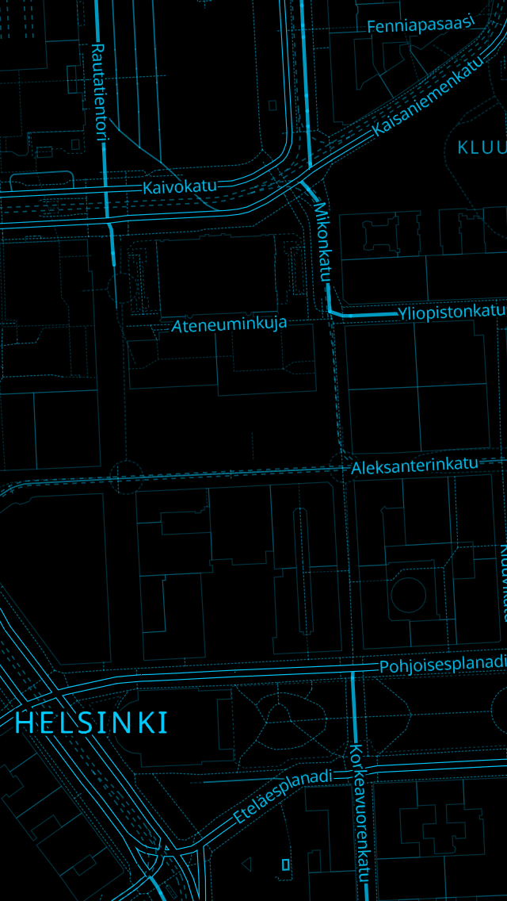
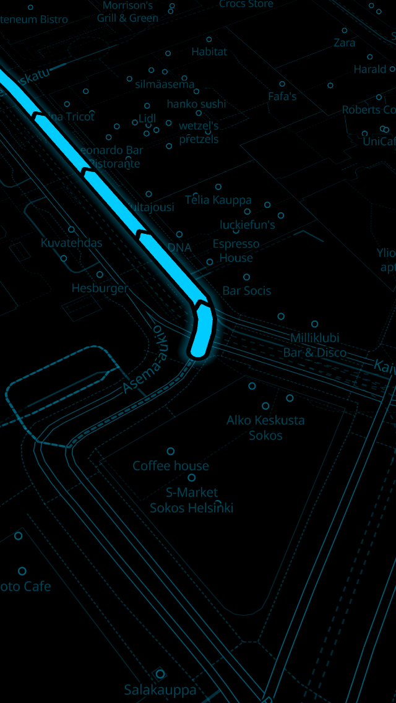
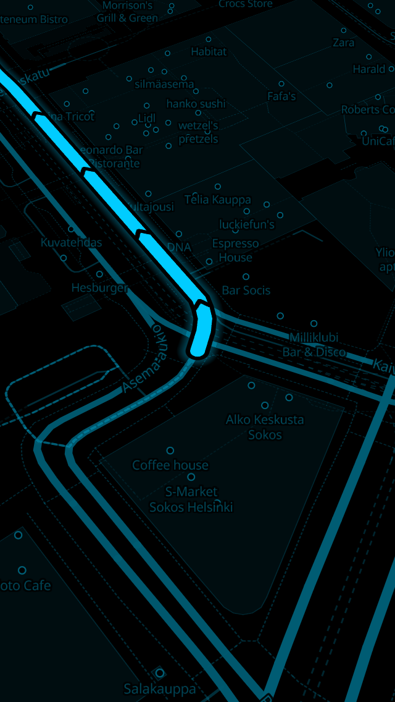
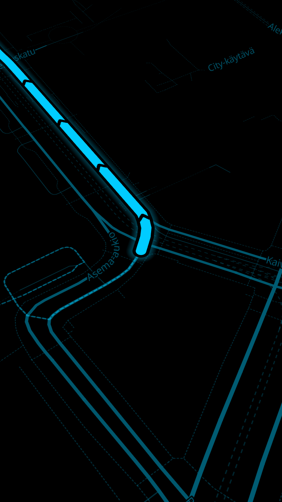

# TRACE//ZERO

Offline maps and turn-by-turn navigation for the iPhone 5s (iOS 12), built
so it can move to current iPhones without a rewrite.

Nothing talks to a server. Maps, routing and search come from **map packs**
(`.vmap` folders) built on a Mac and copied to the phone with Finder.

<p>




</p>

## What it does

- **Vector map in black and `#00CCFF`**, four render modes: outline
  (wireframe), diagonal hatch, solid and minimal. Red is used only for the
  destination.
- **A route you cannot confuse with a road.** It is wider than any road,
  drawn as glow + black gap + bright core with black direction chevrons,
  and the rest of the map dims while you navigate. The part already driven
  turns into a faint dotted line. See [docs/MAP-STYLE.md](docs/MAP-STYLE.md).
- **Fast routing on big cities and whole countries.** Routes come from a
  contraction hierarchy built on the Mac: a query touches a few hundred
  nodes instead of millions. On a 360,000-junction test city a route takes
  about 1 ms on a desktop CPU; even if the A7 is 10–20× slower, that is
  tens of milliseconds. See [docs/ROUTING.md](docs/ROUTING.md).
- Walking (default), cycling and driving, with one-way streets, turn
  restrictions, barriers, traffic signals and ferries.
- Turn-by-turn instructions, offline voice guidance, automatic reroute
  (instant thanks to the fast router), arrival detection.
- Offline search for places, streets, addresses, points of interest and
  typed coordinates (`47.4979, 19.0402`, `N47 29.873 E19 2.412`, DMS…),
  accent-insensitive ("vaci ut" finds "Váci út").
- **CarPlay**: map, search, route preview and guidance on the car screen.
  Needs an entitlement Apple only grants on request; on a jailbroken phone
  it can be added when signing. See [docs/CARPLAY.md](docs/CARPLAY.md).
- Portrait and landscape layouts tuned for the 4-inch screen. Navigation
  pauses when the app or screen sleeps, unless you enable background
  navigation or CarPlay is connected.
- One `.vmap` folder per country or region. Copy and delete them in
  Finder; the app notices them without an import step.

## Quick start

1. **Build a map pack on the Mac**: open
   `MapBuilder/MapForge.xcodeproj`, press Run, pick a region, press FORGE.
   Or run `Forge/forge.sh hungary` in Terminal
   ([MapBuilder/README.md](MapBuilder/README.md)).
2. **Install the app**: build an IPA for the jailbroken phone with
   `Tools/build-ipa.sh`, or open `TraceZero.xcodeproj` and run it on the
   phone. This needs Xcode 16 or 26: Xcode 27 can no longer build for
   iOS 12, but Xcode 26 can be installed next to it and the script uses it
   automatically ([docs/INSTALL.md](docs/INSTALL.md)).
3. **Copy the pack**: Finder → iPhone → Files → drag `hungary.vmap` onto
   TRACE//ZERO.

## Repository layout

| Path | What |
|---|---|
| `Core/` | Portable C99 library: routing queries, snapping, instructions, search, text normalisation, coordinate parsing. Used by the app and the builder. |
| `Forge/` | `tzforge` (C) builds routing and search files from OSM data; `forge.sh` runs the whole pack pipeline. |
| `MapBuilder/` | TRACE ZERO MAP FORGE, the Mac app around `forge.sh`. |
| `App/` | The iOS app (Swift, UIKit), resources, Info.plist, CarPlay entitlement. |
| `TraceZero.xcodeproj` | Generated by `Tools/gen_xcodeproj.py`. |
| `Tests/` | C unit tests, a real OSM extract (central Helsinki) and a synthetic city generator. |
| `Tools/` | Style generator, icon generator, project generator, IPA builder, style preview. |
| `docs/` | How everything works and why. |

## Documentation

- [docs/INSTALL.md](docs/INSTALL.md): Xcode, signing, the jailbreak IPA route
- [docs/ARCHITECTURE.md](docs/ARCHITECTURE.md): the layers and how data flows
- [docs/ROUTING.md](docs/ROUTING.md): profiles, turn restrictions, contraction hierarchies, instructions
- [docs/MAP-STYLE.md](docs/MAP-STYLE.md): render modes and the route design
- [docs/FILE-FORMATS.md](docs/FILE-FORMATS.md): what is inside a `.vmap` pack
- [docs/PORTING.md](docs/PORTING.md): moving to current iPhones and iOS versions
- [docs/CARPLAY.md](docs/CARPLAY.md): CarPlay and its entitlement
- [docs/DECISIONS.md](docs/DECISIONS.md): decisions, what was tested, and known limits

## Tests

```bash
make -C Tests
```

builds the core and builder with address/undefined-behaviour sanitizers,
runs 344 unit checks, builds packs from real Helsinki data and from a
synthetic 200×200 street grid, and compares every routing graph against
plain Dijkstra on random pairs (they must match exactly).

## Data and attribution

Map data © OpenStreetMap contributors, available under the Open Database
License. Keep the in-app attribution visible. Tiles are made with
Planetiler (OpenMapTiles schema). Rendering by MapLibre Native. Labels use
Noto Sans (SIL Open Font License).
