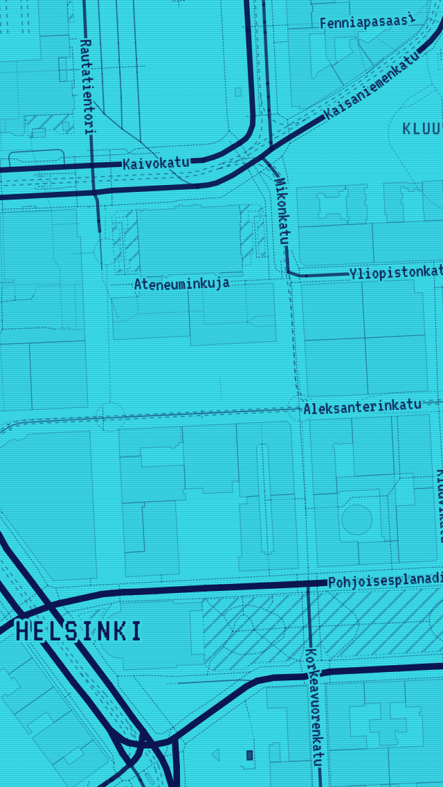
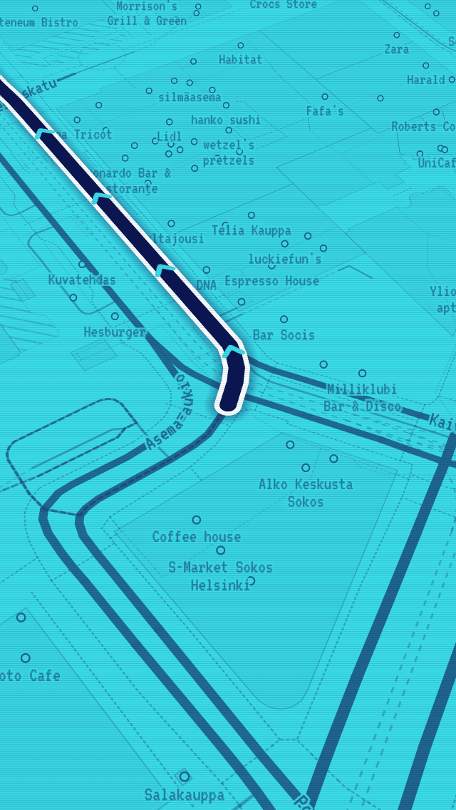
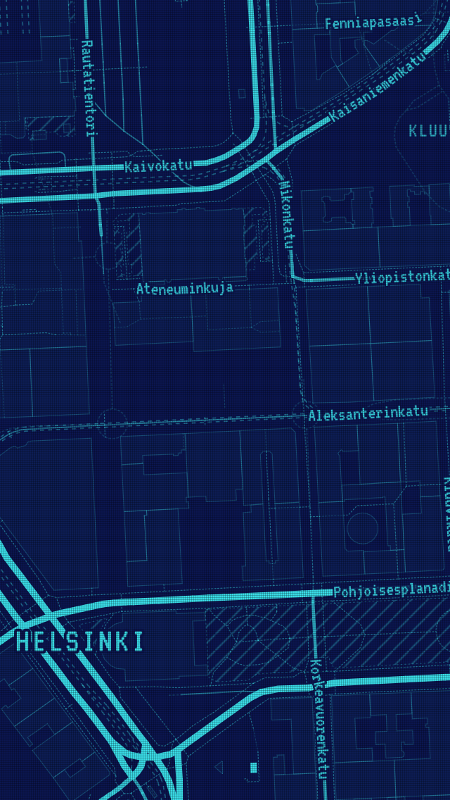
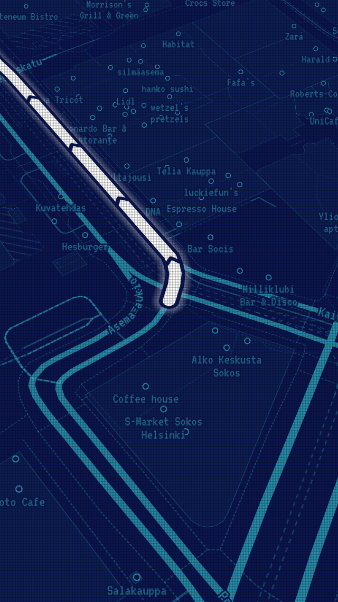

# Map style

The styles are generated by `Tools/make_styles.py` into
`App/Resources/Styles/{outline,hatch,solid,minimal,walker,walker-inverted}.json`. Edit the
script, never the JSON, then run:

```bash
python3 Tools/make_styles.py
```

They use the OpenMapTiles schema that Planetiler produces, so any
OpenMapTiles-compatible tiles work.

## Two colours

Black background, cyan `#00CCFF` for everything on the map, red `#FF2B3A`
only for the destination. Importance is shown with brightness, width and
line pattern, not with more colours. (The WALKER styles are the
exception; see below.)

## Render modes

| Mode | Look | Use |
|---|---|---|
| OUTLINE | Major roads as two thin parallel lines (wireframe), outlined water, parks and buildings | Default |
| HATCH | Solid roads, diagonal hatching for water and green areas | |
| SOLID | Filled areas at low brightness, solid roads | Most readable in sunlight |
| MINIMAL | Roads, water outlines and labels only | Fastest; saves battery |
| WALKER | The Alan Walker world: cyan screen, navy lines, indigo water, pixel font; the whole app follows | The map in Alan Walker's "Alone" video |
| WALKER INVERTED | The same world inverted: navy screen, cyan lines and water, dot matrix | |

Switch with the layers button on the map or in Settings.

## Telling the route apart from roads

This was the top request. Several cues work together, so the route stays
obvious in every mode, at every zoom, in sunlight and at a glance:

1. **Width.** The route core is wider than any road at every zoom level
   (11 px at zoom 16, against about 7 px for a motorway and 3 px for a
   residential street).
2. **Sandwich.** Glow, then a black gap, then a bright core. No road has
   a black border inside a glow, so the route looks like a different kind
   of object, not a brighter road.
3. **Chevrons.** Black arrows on the core point in the direction of
   travel. Nothing else on the map has them.
4. **Dimming.** While navigating, a black veil (55%) covers the base map
   *below* the route, so every road gets darker and the route does not.
5. **Less clutter.** Shop and café labels and house numbers are hidden
   while navigating (can be turned off in Settings).
6. **Travelled part.** Behind you the route becomes a thin dotted line, so
   the bright line always shows only what is still ahead.
7. **Next maneuver.** A cyan ring marks the junction of the next turn.

Layer order (bottom to top): base map → road labels → **dim veil** →
travelled route → route glow → gap → core → chevrons → maneuver ring →
place names → pin → destination.

## WALKER and WALKER INVERTED






The world of the phone map in Alan Walker's "Alone" video. Unlike the
other styles this is a whole look, not just a map: when a WALKER style is
selected, the **entire app** moves into it (panels, buttons, banner,
search, settings, the VT323 pixel font), and navigation happens inside
that world. Switching to or from a WALKER style rebuilds the screen
(`AppDelegate.applyLook`); a running navigation carries on.

Both maps use the same layers, widths and zoom rules as SOLID; only
colours, the font and a few details change (`walker_style()` in
`Tools/make_styles.py`):

| | WALKER | WALKER INVERTED |
|---|---|---|
| Screen (background) | `#3ADCE8` bright cyan | `#0B1650` navy |
| Roads, outlines, labels | `#0B1650` navy | `#3ADCE8` cyan |
| Water | `#2233B8` royal indigo | `#3ADCE8` bright cyan |
| Parks, forests | navy hatching (`hatch-navy`) | cyan hatching (`hatch-cyan`) |
| Route | navy core in a **white** band, navy glow, cyan chevrons | **white** core, navy band, white glow, navy chevrons |
| Destination | coral `#FF6B7E` ring | coral ring |
| Screen texture | scanlines | dot matrix |
| App panels | royal navy `#1A2A9E`, cyan pixel text | cyan, navy pixel text |

- **Route:** white appears nowhere else on these maps, so the route
  cannot be mistaken for a road; coral is used only for the destination.
  All the rules above still hold, except that the veil while navigating
  is lighter (40% instead of 55%) so the world stays visible.
- **Destination:** a coral ring (screen-coloured centre, coral stroke,
  soft coral halo) with a small centre dot.
- **Texture:** `MapController` lays a fine texture over the map:
  scanlines (one faint navy device-pixel line every three) on WALKER, a
  dot-matrix grid on WALKER INVERTED. It is a plain non-interactive view
  above MapLibre's drawing surface, so it costs nothing per frame. The map
  view's background and tint colour also follow the style, so there is no
  black flash and the GPS accuracy circle stays visible.
- **Interface:** every colour and font of the app comes from
  `App/Sources/UI/Theme.swift`, whose `look` follows the style
  (`RenderMode.look`). CarPlay keeps its standard look.

## Images

The styles reference images that the app draws at runtime
(`App/Sources/Map/MapImages.swift`): `hatch`, `hatch-water` and `chevron`,
plus `hatch-navy`, `hatch-cyan`, `chevron-navy` and `chevron-cyan` for
the WALKER styles. No sprite sheet is
needed.

## Labels

Glyphs are bundled in `App/Resources/Glyphs`, so labels work offline:

- `Noto Sans Regular`: used by the four standard styles.
- `Walker Mono`: used by the WALKER styles. It is VT323 (SIL OFL,
  `App/Resources/Fonts/VT323-Regular.ttf`) merged over Noto Sans, so letters
  VT323 lacks (Cyrillic, Greek, Arabic, ...) still show, in Noto. It is
  built by `Tools/make_glyphs.py` (needs `pip install fonttools freetype-py
  numpy scipy`); the output is committed, so you only run it to change the
  font. VT323 is drawn 1.3x larger than its em so its letter height
  matches Noto and the same text sizes work in all styles. The interface uses the same
TTF directly (`UIAppFonts` in `App/Info.plist`).

Chinese, Japanese and Korean are drawn with the phone's own fonts.

## Previewing changes

`Tools/style-preview` renders the styles in a desktop browser with real
data and a real route; the screenshots in `docs/images` come from it.
