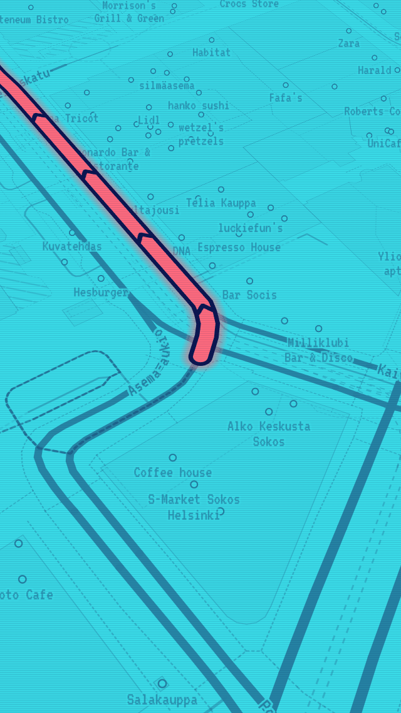

# Map style

The styles are generated by `Tools/make_styles.py` into
`App/Resources/Styles/{outline,hatch,solid,minimal,screen}.json`. Edit the
script, never the JSON, then run:

```bash
python3 Tools/make_styles.py
```

They use the OpenMapTiles schema that Planetiler produces, so any
OpenMapTiles-compatible tiles work.

## Two colours

Black background, cyan `#00CCFF` for everything on the map, red `#FF2B3A`
only for the destination. Importance is shown with brightness, width and
line pattern, not with more colours. (SCREEN is the one exception; see
below.)

## Render modes

| Mode | Look | Use |
|---|---|---|
| OUTLINE | Major roads as two thin parallel lines (wireframe), outlined water, parks and buildings | Default |
| HATCH | Solid roads, diagonal hatching for water and green areas | |
| SOLID | Filled areas at low brightness, solid roads | Most readable in sunlight |
| MINIMAL | Roads, water outlines and labels only | Fastest; saves battery |
| SCREEN | Light "monitor" look: cyan screen, navy lines, indigo water, pixel font, coral route | Looks like the map in Alan Walker's "Alone" video |

Switch with the layers button on the map or in Settings.

## Telling the route apart from roads

This was the top request. Several cues work together, so the route stays
obvious in every mode, at every zoom, in sunlight and at a glance:

1. **Width.** The route core is wider than any road at every zoom level
   (11 px at zoom 16, against about 7 px for a motorway and 3 px for a
   residential street).
2. **Sandwich.** Glow, then a black gap, then a bright core. No road has
   a black border inside a glow, so the route looks like a different kind
   of object, not a brighter road.
3. **Chevrons.** Black arrows on the core point in the direction of
   travel. Nothing else on the map has them.
4. **Dimming.** While navigating, a black veil (55%) covers the base map
   *below* the route, so every road gets darker and the route does not.
5. **Less clutter.** Shop and café labels and house numbers are hidden
   while navigating (can be turned off in Settings).
6. **Travelled part.** Behind you the route becomes a thin dotted line, so
   the bright line always shows only what is still ahead.
7. **Next maneuver.** A cyan ring marks the junction of the next turn.

Layer order (bottom to top): base map → road labels → **dim veil** →
travelled route → route glow → gap → core → chevrons → maneuver ring →
place names → pin → destination.

## SCREEN mode




The inverse of the other four. It uses the same layers, widths and zoom
rules as SOLID; only colours, the font and a few details change
(`screen_style()` in `Tools/make_styles.py`):

| Element | Colour |
|---|---|
| Screen (background) | `#3ADCE8` bright cyan |
| Roads, outlines, labels | `#0B1650` navy |
| Water | `#2233B8` royal indigo, filled |
| Parks, forests | navy diagonal hatching (`hatch-dark`) |
| Route and destination | `#FF6B7E` coral, the only warm colour |

- **Route:** coral glow, navy band, coral core and navy chevrons
  (`chevron-navy`). Coral is used nowhere else except the destination, so
  the route still cannot be mistaken for a road. The rules above still hold;
  the veil that dims the map while navigating is cyan here instead of black.
- **Destination:** a coral ring (cyan centre, coral stroke, soft coral
  halo) with a navy centre dot.
- **Font:** labels use the pixel font VT323 (the "Screen Mono" glyphs,
  see Labels below).
- **Scanlines:** `MapController` lays a fine scanline texture over the map
  (one faint navy device-pixel line every three pixels). It is a plain
  non-interactive view above MapLibre's drawing surface, so it costs
  nothing per frame. The map view's background and tint colour also
  follow the mode, so there is no black flash and the GPS accuracy circle
  stays visible.

The app's panels and buttons stay black and cyan in every mode.

## Images

The styles reference images that the app draws at runtime
(`App/Sources/Map/MapImages.swift`): `hatch`, `hatch-water` and `chevron`,
plus `hatch-dark` and `chevron-navy` for SCREEN. No sprite sheet is
needed.

## Labels

Glyphs are bundled in `App/Resources/Glyphs`, so labels work offline:

- `Noto Sans Regular`: used by the four dark modes.
- `Screen Mono`: used by SCREEN. It is VT323 (SIL OFL,
  `Branding/fonts/VT323-Regular.ttf`) merged over Noto Sans, so letters
  VT323 lacks (Cyrillic, Greek, Arabic, ...) still show, in Noto. It is
  built by `Tools/make_glyphs.py` (needs `pip install fonttools freetype-py
  numpy scipy`); the output is committed, so you only run it to change the
  font. VT323 is drawn 1.3x larger than its em so its letter height
  matches Noto and the same text sizes work in all five styles.

Chinese, Japanese and Korean are drawn with the phone's own fonts.

## Previewing changes

`Tools/style-preview` renders the styles in a desktop browser with real
data and a real route; the screenshots in `docs/images` come from it.
